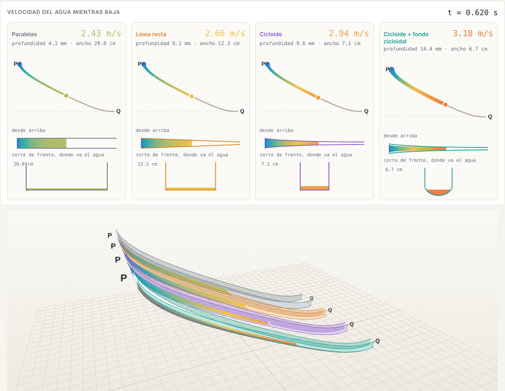

# Canal de agua: ¿qué forma la hace llegar antes?

Simulación de agua real (con viscosidad y roce) bajando por un canal desde un punto P hasta un punto Q, 1 m más abajo y 2 m más adelante. Compara cuatro canales con el mismo fondo y el mismo caudal, que solo se diferencian en la forma de sus paredes y de su corte. Muestra la velocidad del agua mientras baja y el canal en 3D, que se puede girar libremente.

## Uso

1. [Descarga index.html](https://github.com/rodrigo-svg/Interesting-Simultaion/raw/refs/heads/main/Canal-de-agua/index.html) y ábrelo en tu navegador. GitHub muestra el código; el archivo descargado contiene la simulación completa.
2. Ajusta el caudal total, el ancho del canal en P y en Q, y la cámara lenta.
3. En el **caso 4** puedes cambiar las dos cicloides:
   - **Corte de frente:** qué fracción de un arco de cicloide forma el fondo. Con el arco completo (1,00) el fondo es hondo y empalma vertical con las paredes; con fracciones menores es más plano. Siempre es una cicloide verdadera; lo que cambia es el radio del círculo que la genera.
   - **Vista desde arriba:** desde qué punto del arco, t₀, parte el angostamiento. Con t₀ = 0° la pared arranca perpendicular al flujo; con valores mayores arranca más suave.

   Dos gráficos muestran cómo cambia el tiempo de llegada al mover cada parámetro y marcan el mejor valor.
4. En la vista 3D: arrastra para girar, usa la rueda o el gesto de pinza para acercar y haz doble clic para volver a la vista inicial.

No requiere instalación ni conexión a internet: three.js va integrado en el archivo.

## Los cuatro canales

| Canal | Vista desde arriba | Corte de frente |
| :--- | :--- | :--- |
| 1. Paralelas | ancho constante | rectangular |
| 2. Línea recta | se angosta parejo | rectangular |
| 3. Cicloide | se angosta como medio arco de cicloide | rectangular |
| 4. Cicloide + fondo cicloidal | igual que el 3, con t₀ ajustable | arco de cicloide, con fracción ajustable |

En los cuatro, el perfil de bajada (visto de lado) es la **curva óptima** de una lámina de agua de 10 L/(s·m) sin paredes: la curva de tiempo mínimo calculada con roce (`fuente/curva_optima.js`). Condiciones de laboratorio: agua a 20 °C, canal de acrílico y sin aire ni viento.

## Modelo

Modelo unidimensional: en cada punto del recorrido se toma la velocidad media V del agua en el corte del canal. Si el corte tiene área A y perímetro mojado P (fondo más paredes):

$$Q = V\,A,\qquad R = \frac{A}{P},\qquad V\frac{dV}{ds} = g\sin\theta - \frac{f\,V^2}{8R}.$$

- f es el factor de fricción de Darcy: 96/Re si el flujo es laminar y Colebrook (canal abierto, rugosidad ε/12R) si es turbulento, con Re = 4RV/ν. La viscosidad ν depende de la temperatura.
- El agua entra en P en flujo crítico, como si cayera sobre un borde: V₀² = g·A/T, donde T es el ancho de la superficie del agua.
- **Corte cicloidal:** tramo φ ∈ [π−α, π+α] de una cicloide de radio r, con z = r(φ − sen φ) − πr y ζ = r(1 + cos φ). El área, el perímetro mojado y el ancho de la superficie se calculan con fórmulas exactas. Por encima del borde del arco, las paredes siguen verticales.
- **Ondas cruzadas:** cuando una pared estrecha agua rápida se forma un resalto oblicuo. Se calcula con la teoría de Ippen y se descuenta, de una sola vez, la energía que pierde el peor resalto del recorrido. Es una estimación pesimista.

## Resultados (valores por defecto: 2 L/s, ancho de 20 cm en P y 5 cm en Q)

| Canal | Tiempo P→Q (con ondas cruzadas) | Velocidad en Q |
| :--- | ---: | ---: |
| 4. Cicloide + fondo cicloidal | **0,899 s** | 3,23 m/s |
| 3. Cicloide | 0,944 s | 3,01 m/s |
| 2. Línea recta | 0,991 s | 2,74 m/s |
| 1. Paralelas | 1,078 s | 2,03 m/s |
| Lámina sin paredes (referencia) | 1,066 s | 2,08 m/s |

- Angostar el canal junta el agua en una capa más gruesa, que roza menos en proporción. Por eso gana el canal que se angosta antes.
- Un fondo en U ayuda todavía más, porque la misma agua moja menos superficie. Con paredes paralelas y fondo cicloidal se obtienen 0,927 s, mejor que el canal 3: la forma del corte pesa más que cuánto se angosta el canal.
- En el caso 4, lo mejor es el arco completo en el corte, y en la vista desde arriba un inicio cercano a t₀ ≈ 20°–30°: el tiempo baja a **0,893 s**, porque así se evita el choque brusco en la entrada. El cambio entre 15° y 20° es abrupto porque ahí el resalto pasa de desprendido a adherido en la estimación de ondas cruzadas; el valor exacto del óptimo es menos confiable que su tendencia.

## Validación

- Con paredes paralelas y sin roce lateral, el modelo reproduce el tiempo de la lámina sin paredes: 1,06574 s contra 1,06576 s (diferencia de 0,002 %, por la resolución de la malla).
- Las fórmulas del corte cicloidal (área, perímetro mojado y ancho de la superficie) coinciden con una integración numérica directa hasta la quinta cifra, para arcos completos y parciales.
- El resalto oblicuo reproduce el caso clásico de Froude 4 y desvío de 10°: ángulo de onda 23,5° y razón de alturas 1,81.
- La curva óptima del fondo cumple la condición de optimalidad (principio de Pontryagin) en toda su longitud, y una implementación independiente en Python da el mismo tiempo con 4 decimales.

## Límites

- Se supone la misma velocidad en todo el corte. En un fondo en U real, el agua de las orillas va más lenta, lo que probablemente reduce un poco la ventaja del caso 4.
- No se modelan las ondas que rebotan de pared a pared aguas abajo ni la tensión superficial.
- La teoría de resaltos oblicuos está hecha para cortes rectangulares; en el corte cicloidal es una aproximación.
- El fondo no se volvió a optimizar para cada canal: es la curva óptima de la lámina sin paredes. Optimizar juntos el fondo, el ancho y el corte daría tiempos aún menores.
- Es un modelo de ingeniería, no una solución de Navier–Stokes. Confirmarlo requiere un experimento o una simulación CFD.

## Archivos

- `index.html`: simulación completa en un solo archivo, con three.js integrado.
- `portada.png`: captura de la simulación.
- `fuente/index.src.html`: la página antes de integrar los datos y three.js.
- `fuente/canal.js`: física del canal (cortes, roce, integración, resaltos oblicuos).
- `fuente/curva_optima.js`: calcula la curva óptima del fondo. Se ejecuta con `node curva_optima.js > base.json`.
- `fuente/base.json`: puntos de la curva óptima.
- `fuente/construir.py`: arma `index.html` a partir de las fuentes. Requiere `npm install three@0.128.0`.

Usa [three.js](https://threejs.org) r128 (licencia MIT) para la vista 3D.
