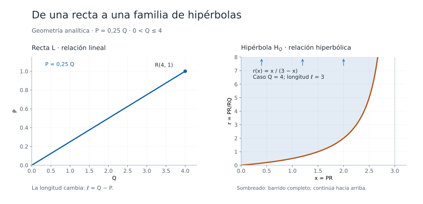

# Recta e hipérbola

Explorador de geometría analítica: una relación lineal entre las coordenadas de los extremos de un segmento determina una familia de hipérbolas.

## Uso

1. Descarga `recta-e-hiperbola.zip`, descomprímelo y abre `recta-e-hiperbola.html` en tu navegador.

   
2. Mueve Q con el deslizador. Edita la pendiente m, el término independiente b y el límite superior de Q.
3. Usa la rueda, los botones o el gesto de pinza para ampliar cada gráfico; arrastra para desplazarte. Las vistas son independientes y las escalas siempre son lineales.

No requiere instalación, conexión a internet ni bibliotecas externas. En pantallas anchas los gráficos aparecen uno junto al otro; en móviles se apilan.

## Modelo

P y Q representan las **coordenadas de los extremos** sobre una recta numérica. El gráfico izquierdo tiene Q en el eje horizontal y P en el vertical:

$$L:\quad P=mQ+b.$$

Para P<Q, la longitud es $\ell=Q-P=(1-m)Q-b$. Si R recorre el interior del segmento y $x=PR$, entonces:

$$H_Q:\quad r_Q(x)=\frac{PR}{RQ}=\frac{x}{\ell-x},\qquad 0<x<\ell.$$

El deslizador selecciona un segmento y, por tanto, una sola hipérbola. La pendiente m de L es constante mientras no se edite; la razón r varía a lo largo de cada segmento. Con b distinto de cero, L es una relación afín.

**Caso base:** m=0,25, b=0, Q=4, P=1 y ℓ=3. Así, $r(x)=x/(3-x)$. Si Q=2, entonces P=0,5 y ℓ=1,5: el dominio cambia a $0<x<1,5$.

Si P=Q el segmento es degenerado. Si P>Q, este modelo de división interior con x positivo no aplica. La interfaz lo indica y deja de dibujar la hipérbola.

## Región barrida de la portada

En el caso base, al recorrer $0<Q\leq4$, la longitud recorre $0<\ell\leq3$. La unión exacta de las gráficas interiores es:

$$\left\{(x,r):0<x<3,\quad r\geq\frac{x}{3-x}\right\}.$$

El sombreado representa esa unión, que no tiene cota superior. La curva naranja es su frontera incluida, correspondiente a Q=4. El borde x=0 queda excluido porque R se considera interior. La imagen muestra una ventana finita del conjunto; las flechas indican su continuación.

## Archivos

- `recta-e-hiperbola.html`: aplicación completa, con estilos y JavaScript integrados.
- `recta-e-hiperbola.zip`: el mismo HTML comprimido; es lo que baja el botón Descargar.
- `recta-e-hiperbola.svg`: figura vectorial con los nombres, ecuaciones y región barrida del caso base.

Los otros experimentos del repositorio permanecen disponibles en su página principal.
