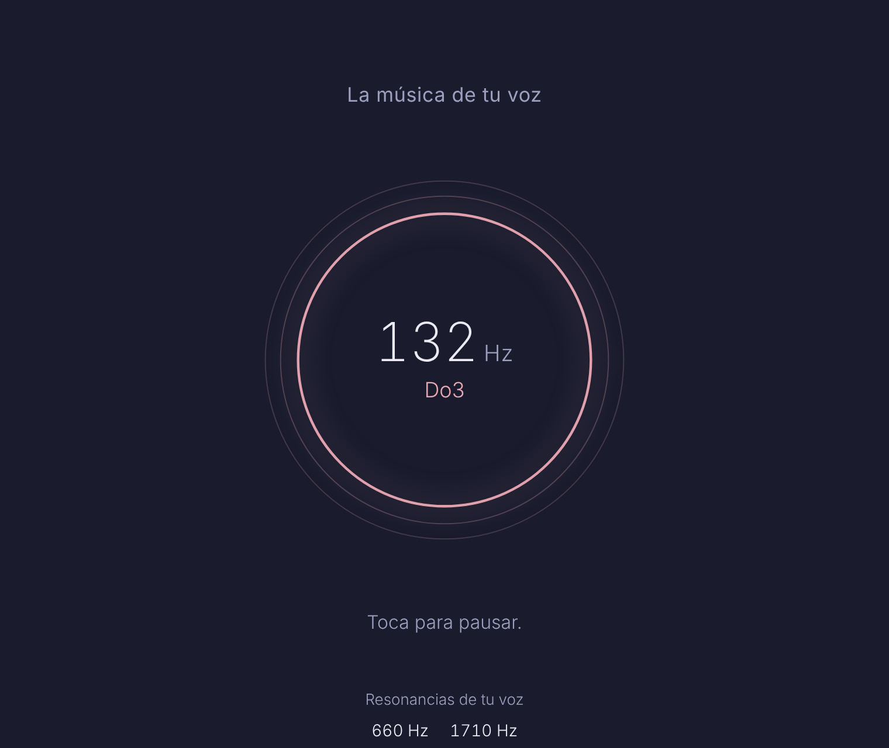

# La música de tu voz

Escucha una voz, mide su frecuencia y genera música tranquila afinada a ella.

## Uso

1. [Descarga index.html](https://github.com/rodrigo-svg/Interesting-Simultaion/raw/refs/heads/main/Musica-de-tu-voz/index.html) y ábrelo en tu navegador.
2. Toca el círculo y sostén una «aaa» unos segundos, o sube un audio con la voz.
3. Toca el círculo para pausar o seguir.

No requiere instalación, conexión a internet ni bibliotecas externas. El audio se analiza en el dispositivo y no se envía a ningún lugar.

## Qué mide

- **Frecuencia de la voz:** el tono fundamental (f0), la frecuencia a la que vibran las cuerdas vocales. Es la mediana de los tramos con voz, calculada con el método YIN.
- **Resonancias:** los formantes, que son las frecuencias que refuerza el tracto vocal. Se obtienen de la envolvente espectral por predicción lineal. Cambian con la vocal, por eso conviene sostener una «aaa».

## Qué suena

- Un bordón en la frecuencia de la voz y su quinta, que sube y baja cada 10 segundos.
- Acordes lentos en una escala pentatónica de afinación justa construida sobre esa frecuencia, filtrados por las resonancias medidas.
- Notas sueltas, tipo campana, en la misma escala.

## Archivos

- `index.html`: aplicación completa, con estilos y JavaScript integrados.
- `portada.png`: captura de la aplicación.
