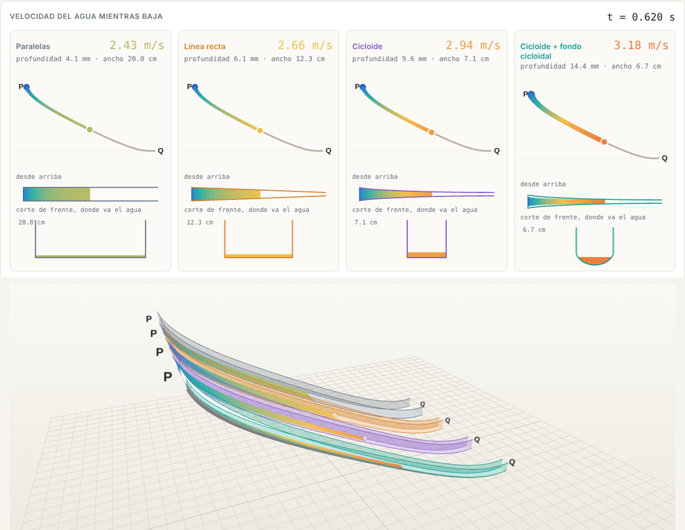
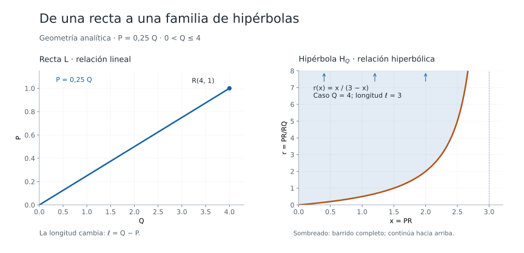

# Interesting-Simultaion

Aqui se presentarán simulaciones de los campos de la física, la biologia y las matematicas. Cada simulación cuenta con su código, requisitos y definicion de parametros, ademas de una breve explicación de lo que se simula.

---
## Canal de agua: ¿qué forma la hace llegar antes?

Agua real (con viscosidad y roce) bajando de P a Q por cuatro canales con el mismo fondo y el mismo caudal: paredes paralelas, que se angostan en línea recta, que se angostan como cicloide, y cicloide con fondo cicloidal. Muestra la velocidad del agua mientras baja y el canal en 3D, que se puede girar. En el caso 4, las dos cicloides tienen parámetros ajustables.

**[Abrir el proyecto y las instrucciones](./Canal-de-agua/)** · [Descargar la simulación HTML](https://github.com/rodrigo-svg/Interesting-Simultaion/raw/refs/heads/main/Canal-de-agua/index.html)

---
## Geometría analítica: recta e hipérbola

Un explorador interactivo de la relación entre los extremos de un segmento y su razón de división interior. Incluye parámetros editables, ecuaciones actualizadas y zoom independiente en ambos gráficos.

**[Abrir el proyecto y las instrucciones](./Geometria-analitica/)** · [Descargar el explorador HTML](https://github.com/rodrigo-svg/Interesting-Simultaion/raw/refs/heads/main/Geometria-analitica/index.html)

---

## Previas
| Simulación | Enlace Visual |
| :--- | :--- |
| **Fluido Cuántico** | [Simulación](./Fluido%20Cuántico/fluido_cuantico.gif) |
| **Crecimiento Fractal** |  [Visualizar GIF](./crecimiento_fractal.gif) |

## 1. Fluido Cuántico (Ecuación Ginzburg-Landau)
[Ver Simulación](./Fluido%20Cuántico/fluido_cuantico.gif)

**Descripción:**
Simulación de la ecuación compleja de Ginzburg-Landau (CGL), que modela la transición al caos y la formación de defectos topológicos (vórtices) en fluidos cuánticos y sistemas no lineales.

**Parámetros Ajustables:**
* `ALPHA`: Controla la difusión compleja (difusión + dispersión).
* `BETA`: Define la no-linealidad reactiva del sistema.
* `GAMMA`: Determina la ruptura de simetría (acoplamiento al conjugado).

**Requisitos:**
- Python 3.x, `numpy`, `pygame`, `imageio` 

---

## 2. Patrones de Turing (Modelo Gray-Scott)
[Simulación](./crecimiento_fractal.gif)

**Descripción:**
Simulación de sistemas de Reacción-Difusión basada en el modelo de Gray-Scott. Representa la interacción química entre dos sustancias que genera patrones fractales y estructuras ramificadas similares a procesos biológicos.

**Parámetros Ajustables:**
* `feed_rate`: Velocidad de alimentación del nutriente al sistema.
* `kill_rate`: Tasa de eliminación de la sustancia reactiva.
* `dt`: Paso de tiempo (afecta la velocidad y estabilidad de la reacción).

**Requisitos:**
- Python 3.x, `numpy`, `pygame`, `imageio` 

